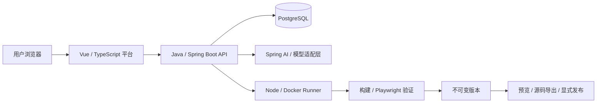

# CodeLess

## 项目介绍

CodeLess 是面向受控试用的自然语言前端应用生成平台。登录后描述需求，生成受控 Vue 应用，查看真实构建和浏览器验证结果，再进行组件编辑、版本查看、截图、源码导出和显式发布。生成应用只使用静态数据、Mock 或 LocalStorage。

主要使用场景包括个人展示页、活动介绍页，以及使用 LocalStorage 的任务管理与搜索分类页。平台将需求描述、生成验证、组件修改和版本交付串联起来，方便用户持续调整应用。

## 安装与运行指南

### 自动安装与演示

从全新目录开始请按 [安装指南](docs/install.md) 操作，包含 Windows PowerShell 与 bash、数据库、账号初始化、API/前端启动、Mock 全产品演示与真实模型请求。失败查 [排障指南](docs/troubleshooting.md)。

```sh
git clone https://github.com/Echo-love928/CodeLess.git codeless
cd codeless
corepack pnpm install --frozen-lockfile
node tests/e2e/full/record-command.mjs full
```

先准备下表工具、Docker Engine、Git OpenSSL（Windows），并把 Corepack pnpm shim 放在 PATH 首部，详见安装指南。该自动演示创建隔离数据库、运行迁移、启动 API/本地 HTTPS 站点并在 Chromium 执行业务，结束后清理本轮进程和容器。模型为 deterministic-mock，构建、数据库和浏览器真实执行；持续交互服务、公网部署和真实模型另行配置。


### 持续本地开发

以下命令在仓库根目录执行。先按安装指南准备 Java、Node、pnpm、Docker 与 Chromium；首次复制配置，已有 `.env` 时直接编辑，避免覆盖：

```sh
# bash；PowerShell 使用 Copy-Item .env.example .env
cp .env.example .env
node infra/check-config.mjs .env
docker compose --env-file .env -f infra/compose.dev.yml -p codeless-d23-local up -d --wait postgres
```

在私有 `.env` 中设置两个不同且各至少 12 字符的 `CODELESS_DEMO_PASSWORD`、`CODELESS_ADMIN_PASSWORD`；两者均为空不创建账号，只填一个会启动失败。本机 HTTP 登录使用 `CODELESS_COOKIE_SECURE=false`。

Compose 不会启动宿主 API/Vite，`--env-file` 也不会把变量注入宿主 Java 进程。Bash 在启动 API 的同一终端加载受信任的本机配置：

```sh
set -a
. ./.env
set +a
./services/api/mvnw -f services/api/pom.xml spring-boot:run
```

PowerShell 按模板的 `NAME=value` 格式读取配置，不执行文件内容：

```powershell
Get-Content .env | ForEach-Object {
  if ($_ -match '^([A-Z][A-Z0-9_]*)=(.*)$') {
    [Environment]::SetEnvironmentVariable($Matches[1], $Matches[2], 'Process')
  }
}
.\services\api\mvnw.cmd -f services/api/pom.xml spring-boot:run
```

另开已准备好 PATH 的终端，执行 `pnpm --filter @codeless/web dev`。API 健康检查为 `http://127.0.0.1:8080/api/health`，预期返回 `status: "UP"`；前端入口为 `http://127.0.0.1:5173/login`，使用 `demo@codeless.local` 或 `admin@codeless.local` 与私有配置的密码登录。初始化不会重置已有账号密码。

基础启动用于登录和应用管理。完整生成、预览和发布还需 Agent、私有存储、预览签名与托管配置，详见 [完整安装指南](docs/install.md)。首次完整验收可使用上面的自动 Mock 演示。

停止 API/Vite 时在各终端按 `Ctrl+C`，再执行：

```sh
docker compose --env-file .env -f infra/compose.dev.yml -p codeless-d23-local down
```

该命令保留数据库卷。只有确定要删除开发数据时才另行清卷。

## 环境配置

仓库提供可复制的 [环境变量模板](.env.example)。复制后的 `.env` 已被 Git 忽略，仅在本机保存；模板中的数据库密码只适合隔离的本地开发。导入方式支持模板的单行 `NAME=value`，不支持引号、插值或多行值。

| 环境变量 | 用途与配置要求 |
| --- | --- |
| `POSTGRES_DB` / `POSTGRES_USER` / `POSTGRES_PASSWORD` | Compose 数据库初始化；共享环境需替换开发凭据 |
| `POSTGRES_PORT` | 本地数据库端口，默认 15432 |
| `CODELESS_DATABASE_URL` / `CODELESS_DATABASE_USER` / `CODELESS_DATABASE_PASSWORD` | API 的 JDBC 连接，需与上述数据库名称、端口和凭据一致 |
| `CODELESS_COOKIE_SECURE` | 模板为本机 HTTP 设置 false；共享 HTTPS 部署必须为 true |
| `CODELESS_DEMO_PASSWORD` / `CODELESS_ADMIN_PASSWORD` | 可选演示账号密码；同时设置、互不相同且各至少 12 字符，或同时留空 |
| `CODELESS_MODEL_PROVIDER` | 默认 deterministic-mock；真实模型使用 deepseek |
| `CODELESS_MODEL_NAME` / `CODELESS_MODEL_API_KEY` | 真实模型模式必须提供；Mock 模式无需凭据，密钥通过私有环境注入 |
| `CODELESS_PLATFORM_DOMAIN` / `CODELESS_PREVIEW_DOMAIN` / `CODELESS_PUBLICATION_DOMAIN` | 三类网关域名，模板 .test 域名为本地示例 |
| `CODELESS_PLATFORM_PORT` / `CODELESS_PREVIEW_PORT` / `CODELESS_PUBLICATION_PORT` | 网关端口，默认 18080 / 18081 / 18082 |
| `CODELESS_STORAGE_DIR` | 基础设施预留存储路径，不代替业务私有存储配置 |
| `CODELESS_PLATFORM_SIGNING_KEY` | 平台集成预留项，按对应模块要求配置 |
| `CODELESS_PUBLICATION_ENABLED` | 默认 false；开启前需完成托管与站点配置 |

`node infra/check-config.mjs .env` 校验开发数据库与网关配置，不验证全部模型或生产配置。平台密钥与数据库凭据不得挂载到生成容器。更多说明见 [开发环境](docs/environment.md)、[Runner](infra/runner/README.md)、[预览服务](infra/preview/README.md) 和 [发布托管](infra/hosting/README.md)。

## 依赖清单

### 工具与服务版本

| 工具/框架 | 版本及来源 |
| --- | --- |
| Java | 21，services/api/pom.xml |
| Spring Boot / Spring AI BOM | 4.1.1 / 2.0.1，services/api/pom.xml |
| Maven | 3.9.11，仓库 Wrapper |
| Node.js / pnpm | 24.22.1 / 12.6.0，根 package.json |
| PostgreSQL | 17.6-alpine，Compose 与测试固定摘要 |
| Playwright | 1.60.0，根锁文件；使用配套 Chromium |

沿用 [ADR-005](docs/architecture.md) 与既有 Node 安全升级，不安装 latest、不重建锁文件。平台 workspace 使用根 pnpm-lock.yaml，生成项目使用 templates/vue/pnpm-lock.yaml，两者独立。

### 应用与开发依赖

| 类别 | 主要依赖 | 完整清单 |
| --- | --- | --- |
| 平台前端 | Vue 3.5.13、Vue Router 4.5.0、Element Plus 2.9.7 | [apps/web/package.json](apps/web/package.json) |
| 构建与类型检查 | TypeScript 5.8.2、Vite 6.2.3、vue-tsc 2.2.8、Vue Vite 插件 5.2.3 | [apps/web/package.json](apps/web/package.json) |
| 前端质量检查 | ESLint 9.23.0、Vitest 3.0.9、Vue Test Utils 2.4.6、Playwright 1.60.0 | [apps/web/package.json](apps/web/package.json) |
| Java 服务 | Spring Boot 4.1.1、Spring AI BOM 2.0.1、Web、Validation、JDBC、Flyway、Security Crypto、PostgreSQL JDBC | [services/api/pom.xml](services/api/pom.xml) |
| Java 测试 | Spring Boot Test、Testcontainers PostgreSQL 2.0.5 | [services/api/pom.xml](services/api/pom.xml) |
| 契约校验 | Redocly CLI 2.54.3、Ajv 8.20.0、ajv-formats 3.0.1 | [package.json](package.json) |
| 生成模板 | Vue 3.5.13、Vue Router 4.5.0、TypeScript 5.8.2、Vite 6.2.3 | [templates/vue/package.json](templates/vue/package.json) |

Java 未单独指定版本的依赖由 Maven 父工程/BOM 管理；JavaScript 的传递依赖以对应锁文件为准。开发数据库与网关镜像见 [Compose 配置](infra/compose.dev.yml)，Docker 需要 Compose v2；Windows 使用 Linux 容器模式。

## 技术架构

Vue + TypeScript 平台 UI 调用 Java/Spring API，PostgreSQL 保存账号、任务、版本与部署引用。模型提出 PLAN 与源码补丁，受限 Node/Docker runner 实际构建，Playwright 验证后才能形成 READY/VERIFIED 版本。失败保留最近可用版本，发布须由已鉴权用户显式触发。

模型调用与执行验证分离，API 负责业务编排，Runner 提供受限执行能力：



| 模块 | 主要职责 |
| --- | --- |
| 平台前端 | 登录、应用管理、任务进度、组件编辑、版本与后台界面 |
| API 与 Agent | 会话鉴权、权限控制、模型调用、任务编排和数据持久化 |
| Runner | 受限构建、浏览器验证、截图及预览发布执行 |
| 公共契约 | HTTP 接口、资源 Schema 与合法/非法样例 |

### 仓库结构

```text
apps/web/         平台界面             services/api/       HTTP、鉴权、业务与 Agent
services/runner/  构建、验证、预览发布 templates/vue/      受控 Vue 模板
contracts/        HTTP/JSON 契约       tests/              集成、安全与浏览器验收
infra/            基础设施             docs/               架构、操作与每日交接
```

边界见 [scope](docs/scope.md)，决策见 [architecture](docs/architecture.md)，接口见 [contracts](contracts/README.md)。React、生成后端、支付、开放 shell、多 Agent 和任意依赖安装不在首版范围。生成容器不能得到平台密钥或宿主 Docker socket。

## 验证与源码交付

```sh
node --test tests/install/install.test.mjs
pnpm verify:static
pnpm verify:api
pnpm verify:runner
pnpm verify:e2e
pnpm ci:gate
```

static 检查版本、契约和前端 lint/单测/生产构建；api 执行 Maven verify；runner 执行真实隔离构建与边界检查；e2e 包含浏览器 smoke 和全产品链路。Docker、Java、依赖及配套 Chromium 必须可用。CI 的 infra-preflight 也必须成功，本机结果与最终 PR HEAD 的远端检查分别记录。

源码包从已验证版本下载，包含 README、锁文件和 codeless-export.json。解压到独立目录后按包内 README 安装构建；独立容器核验见 [安装指南](docs/install.md#源码包独立运行)。

## 团队信息与协作

| 成员 | 主要职责 |
| --- | --- |
| 成员 A | API、模型集成与运维流程 |
| 成员 B | 前端、Runner 与交付体验 |

成员标识沿用现有项目文档；具体分工以每日契约和 `docs/handoffs/` 为准。使用独立分支与 PR，由另一位成员审查，不自批、不直接推送 main。必需检查成功且讨论解决后才具备合并条件。

评审入口：[后端仓库交付材料](docs/delivery/backend.md)、[后端讲解脚本](docs/demo/backend-script.md)、[D29-A 验收与交接](docs/handoffs/D29-A.md)。其中记录匿名访问、真实 Git/PR 贡献追溯、状态机/预算/隔离证据及 Windows 材料校验方式。真人彩排和完整录像已按用户最新要求取消，不作为缺口。历史测试、现场运行与真实模型效果分别标注；D28 的历史通过结果不代表 D29 候选门禁通过。安装交付的历史证据见 [D23-B 交接](docs/handoffs/D23-B.md)。
