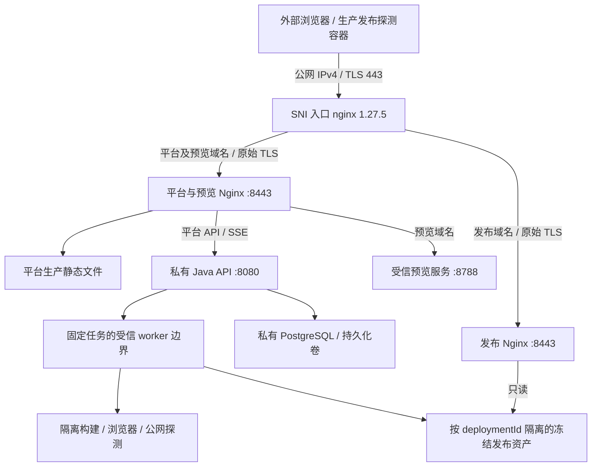

# D15 真实公网实施方案

日期：2026-10-15，Asia/Shanghai。运行时代码基线：`fcc8e2f26ff4e2bc14bf86932d9da3fc39172583`，集成草稿 PR #46。

本文是部署设计和准入条件，尚未实施或通过公网验收。本次仅只读检查源码、官方资料并编写本文；本地测试保持用户要求的暂停状态。
用户提供的“CI 6/6，API223、runner82、E2E54”是该基线的既有记录，不是本文产生的新测试结果。
已知 E2E 首次浏览器启动异常仍保留，单次诊断通过不等于根因已修复。

## 1. 选定的架构

使用一台阿里云中国香港 x86_64 Linux ECS，三个不同主域名，公网 IPv4 直连，标准 HTTPS 443。
一个 SNI 四层入口统一接收 443，按域名转发原始 TLS 到两个内部 Nginx：平台/预览入口、发布入口。
保留现有 Nginx 模板的 HTTP 行为，不通过再加一层 HTTP 缓存、重定向或关闭证书检查凑出成功。



资源目标是个人演示和 D15 公网功能验收，不承诺生产高可用、多任务吞吐或所有最大尺寸输入的性能。

## 2. 服务器和试用方案

| 项目 | 固定选择或准入条件 |
| --- | --- |
| 地域/台数 | 中国香港，1台；创建前确认，不用内地随机地域替代。 |
| 规格 | 付费可选4vCPU/8GiB；个人香港试用按官方当前说明最高2vCPU/8GiB，可作为单任务候选，必须实测既有期限。 |
| 系统 | Ubuntu22.04或24.04 LTS，x86_64；首选公共基础镜像。 |
| 磁盘 | 试用包含的40GiB先保留；受信镜像、浏览器和持久目录准备后检查空间，目标剩余至少10GiB再进入演示。此数为部署余量目标，不是已测最低容量。 |
| 网络 | 实例自带公网IPv4；按使用流量计费，目标峰值100Mbps，以试用页允许范围及费用明细为准。 |
| 额外资源 | 不预购负载均衡、NAT网关、云数据库、对象存储或额外数据盘。 |

修正早先3–5Mbps建议：该带宽可演示小页面，但现有产物上限32MiB，发布和探测共用30秒期限；32MiB在5Mbps下仅理论传输就约54秒。
因此正式方案不把固定3–5Mbps作为所有产物都能验收的保证。按流量峰值不等于固定带宽套餐，也不是保证实际吞吐；必须在现有期限内实测。
若试用页不能提供目标峰值，先记录实际限制和实测结果，不擅自更换收费网络产品。

个人试用是300元抵扣额度、3个月有效期、有每小时抵扣上限，不是所有规格连续运行三个月。
实例/系统盘、流量和额外服务分别核对账单。使用实际香港页面参考价计算时长，不能沿用杭州截图的626小时。
试用到期/额度耗尽不假定自动释放；结束前导出证据和数据，由所有者释放不用的计费资源。

云端只运行演示服务和单任务链路；全量开发门禁仍放在本地或现有CI。内存、磁盘、实际构建耗时不达标时停在资源准入阶段，不提高安全上限或伪造成功。

## 3. 域名和 DNS

2026-10-17 实际资源补充：用户已指定 `codeless-platform.top`、`codeless-preview.top`、
`codeless-publish.top`，使用腾讯云 DNSPod，服务器为 `23.136.172.128`。
实际服务名、五条解析记录与 TLS 覆盖范围以 [实际公网域名配置](D15-public-domains-2026-10-17.md) 为准；
下表保留最初设计示例，不作为实际部署真值。最初阿里云香港资源候选也已由现有授权主机替代，
主机实有配置见 [主机准备记录](D15-public-server-preparation-2026-10-17.md)。

下列名字只是设计示例，尚未注册；购买前替换成实际可用、本人或团队可控制的域名。

| 主域名 | DNS记录名称 | 类型 | 内容 |
| --- | --- | --- | --- |
| example-platform.com | app | A | ECS公网IPv4 |
| example-preview.net | preview | A | 同一公网IPv4 |
| example-preview.net | *.preview | A | 同一公网IPv4 |
| example-public.org | sites | A | 同一公网IPv4 |
| example-public.org | *.sites | A | 同一公网IPv4 |

配置真值为：

```dotenv
CODELESS_PLATFORM_ORIGIN=https://app.example-platform.com
CODELESS_PREVIEW_ORIGIN=https://preview.example-preview.net
CODELESS_PUBLICATION_ORIGIN=https://sites.example-public.org
VITE_CODELESS_PREVIEW_ORIGIN=https://preview.example-preview.net
```

2026-10-17 兼容补充：固定后缀扩展为 test/com/net/org/dev/app/cn/top。
新增 `.cn` / `.top` 仅支持直接注册的两段主域名；多级公共后缀（如 `.com.cn`）和已知共享服务根域名明确拒绝。
三端读取同一版本化策略数据，详见 [域名兼容说明](D15-domain-suffix-compatibility.md)。
可选择三个不同的普通 `.cn` 或 `.top` 主域名；不使用共享服务商主域名下的三个子域名，不把本地 `.test` 当作公网资源。
三个主域名是当前实现的约束，不是一般网站都必须买三个域名。

DNS使用注册商提供的普通权威解析即可。只添加公网A记录：不加AAAA，不启用CDN/代理模式，不用私有解析或hosts把公网域名改成回环/私网地址。
如果已有AAAA、上级通配AAAA或代理自动生成IPv6答复，必须先处理；`preflight.mjs`会拒绝IPv6答复。
普通域名记录和通配记录都要检查权威解析及外部递归解析已生效，不靠浏览器缓存判断。

## 4. TLS 的具体做法

首次短期验收采用 Let's Encrypt + Certbot 手工DNS-01，先用测试CA确认DNS控制流程，再申请正常受信证书。
测试CA证书不能用于生产探测。手工DNS-01需要域名控制者在DNS控制台添加TXT，不要求把DNS API密钥交给聊天或运行时。

申请一张同时覆盖以下五个SAN的证书，供两个内部TLS入口使用：

```text
app.example-platform.com
preview.example-preview.net
*.preview.example-preview.net
sites.example-public.org
*.sites.example-public.org
```

通配证书不覆盖其基准名称，故preview/sites两项和它们的通配项均保留。
Certbot命令形状如下，仅在真实域名和控制权就绪后，由部署者执行并完成交互确认：

```sh
certbot certonly --manual --preferred-challenges dns \
  --cert-name codeless-public \
  -d app.example-platform.com \
  -d preview.example-preview.net -d '*.preview.example-preview.net' \
  -d sites.example-public.org -d '*.sites.example-public.org'
```

按命令实际提示创建TXT；同一名称可能同时需要多个TXT值，不能在验证结束前互相覆盖。
提供完整证书链，而非单独叶证书。对证书SAN、有效期和私钥匹配作部署检查。

证书从受保护的ACME目录分发到 `/etc/codeless/tls/server.pem`、`server.key`。
两个内部Nginx将整个 `/etc/codeless/tls` 只读挂到 `/certs`，仍使用模板的 `/certs/server.pem` 和 `/certs/server.key`。
入口UID/GID按真实Linux运行账号设置，私钥只授予这两个TLS入口所需的读取权限；不chmod成所有人可读，不挂载到模型、API或生成代码容器。

手工DNS模式不会自动续期。短期验收窗口结束前检查实际notAfter并安排后续维护；持续使用时另行接入该DNS服务商的自动DNS插件/受限认证hook，验证成功后再宣称自动续期就绪。
续期使用同目录原子替换文件，然后reload两个TLS入口。目录挂载避免“单个证书文件bind mount仍指向旧inode，仅reload没有加载新证书”的问题。

## 5. 端口与网关装配

| 服务 | 宿主机公网端口 | 内部位置 |
| --- | --- | --- |
| SNI入口 | 443/TCP | 入口容器8443 |
| SSH管理 | 22/TCP，仅管理员公网IP/32 | 宿主机sshd |
| 平台/预览Nginx | 无 | 私有Docker网络，8443 |
| 发布Nginx | 无 | 同一受控入口网络，8443 |
| Java API | 无 | 受防火墙保护的8080，仅平台入口及受信本机服务可达 |
| 预览服务 | 无 | 8788仅入口可达；控制8789只监听127.0.0.1 |
| PostgreSQL | 无 | 5432仅本机/数据库私网 |
| 生成构建容器 | 无 | 保持原network=none及资源限制 |

DNS-01不需要开放80。公网验收使用HTTPS直达，不依赖80跳转。公网不开放8080/8788/8789/5432/2375/2376。

### 必须先补的部署文件

当前仓库尚无这一套三站点统一公网manifest。后续实现一个独立 `infra/public/` 部署包：

1. 只由 `edge` 发布宿主443；另外两个Nginx均不映射宿主端口。
2. 两个内部入口复用既有 `infra/preview/nginx.conf.template` 和 `infra/hosting/nginx.conf.template` 的渲染输出。
3. 统一manifest显式填写所有挂载、服务UID/GID、只读根目录、tmpfs、资源上限和私有网络；不直接叠加旧Compose。
4. 预览入口读取真实平台生产dist；`codeless-publication-config.json`必须位于该dist根目录，与服务器publicOrigin完全一致。
5. 用锁定nginx1.27.5-alpine；部署前检查该镜像的stream/ssl_preread编译或模块支持，再记录实际镜像digest。没有模块支持就阻塞，不临时换latest。

已确认原文件的冲突：`infra/preview/render.mjs`会依据公网origin生成宿主TLS端口443，旧预览Compose映射127.0.0.1:443；发布示例映射0.0.0.0:443。
不能把两份旧Compose原样同时启动，不能把预览公网origin改成18443来回避冲突却仍让前端使用443。

SNI路由固定为：平台精确主机、预览基准名及 `v<32位hex>.preview...` -> 平台/预览入口；发布基准名及 `d<32位hex>.sites...` -> 发布入口。
其他SNI不转发到平台API，默认关闭连接。随机合法但尚未分配的 `d<uuid>.sites...` 必须仍到发布入口并返回真实404。
不使用客户端输入作为任意upstream。入口只转发原始TCP/TLS，不记录预览token所在的HTTP URI，SSE不经过HTTP响应缓冲。
SNI透传保留浏览器的Host、TLS和已有CSP/Cookie处理；两个原模板的行为仍须在组合门禁中验证。

## 6. 私有服务、权限和持久化

软件仍沿用仓库锁定：Java21、Node24.16.0、pnpm12.6.0、Maven3.9.11、PostgreSQL17.6固定digest、Playwright1.60.0、Nginx1.27.5。
平台用生产构建，不将Vite开发服务器5173直接放到公网；不复制Windows node_modules到Linux。
预先准备可信D05构建镜像、探测Node镜像及固定Chromium，避免30秒发布期限内才拉镜像。

建议操作员路径固定为：

```text
/srv/codeless/repository/          固定候选提交，运行账号只读
/srv/codeless/web/                 平台dist和静态发布配置，只读供入口使用
/srv/codeless/private/             日志/源码快照/运行receipt/验证证据，非公网卷
/srv/codeless/publication/sites/   发布资产；只读挂入发布Nginx
/srv/codeless/publication/sites-staging/  同文件系统的私有原子写入区，不挂入Nginx
/srv/codeless/preview/             预览部署渲染输出
/srv/codeless/postgres/            数据库持久化位置，权限按数据库镜像实际UID设置
/etc/codeless/                    受保护运行环境与TLS材料
```

API与预览服务的repository/private/workspace根必须指向同一套真实持久目录，不能沿用不同工作目录下的相对路径。
创建后台服务时核对systemd的ProtectSystem/ReadWritePaths和PrivateTmp；现有预览service只是示例，不应未检查目录权限就复制安装。
预览签名key和registry key是两个不同的32字节随机值；API/预览服务共享各自对应值，但不会进入生成代码容器、前端或Nginx。
数据库密码、演示账号密码另行随机设置；平台Cookie保持Secure、HttpOnly、host-only。秘密不写入Git和公开证据。

### Docker控制权限是部署前置问题

源码中的 `LocalBuildGateway` 和 `NodeDeploymentGateway` 当前以API相同OS身份启动Node；构建和探测进一步调用Docker CLI。
因此不能一边声称“公网API没有Docker控制权限”，一边直接把API用户加入高权限docker组。
原项目计划要求公网API和生成容器不获得Docker socket控制权；公网方案必须把受信worker作为独立权限边界处理。

选定方向是同机独立worker账号和受保护的本地IPC：API只提交固定构建/发布/探测任务，worker重新验证身份、固定动作、版本/摘要、根目录和期限，执行原有受限模块。
不提供任意命令、任意node脚本、任意Docker参数或任意文件挂载；API账号不直接拥有daemon访问权限。
任务取消、IPC断开、30秒deadline及worker清理必须有失败路径证据。接口不新增公开端点，不放宽原模型/HTTP权限。
**该权限桥尚未实现/验证，需A/B按现有BuildGateway和DeploymentGateway边界协调一个最小改动，并独立复审。**
这是上线前需补齐的部署边界，不冒充PR46原网关bean/契约工作已证明了生产权限隔离。

## 7. 部署顺序与停止点

| 阶段 | 操作 | 准入/停止条件 |
| --- | --- | --- |
| A 代码准备 | 补统一公网manifest、SNI模板、目录/服务管理配置和受限worker权限桥；记录候选commit、依赖和镜像digest。 | 用户恢复测试后，受影响测试、组合门禁及独立审查通过；未满足前不启用公网功能。 |
| B 资源核对 | 确认香港实例、额度、IPv4、剩余磁盘、实际2核8GB负载能力及三域名控制权。 | 不自动买收费配件，不把额度估计当保证。 |
| C 基础安装 | 安装锁定软件、预热镜像/Chromium、创建数据库和私有卷、配置受保护服务账号。 | API无daemon控制权；生成容器无秘密/socket；必要目录可写且公网不可读。 |
| D DNS/TLS | 添加五条A记录，申请五SAN正常证书，生成两个入口配置和前端publicOrigin JSON。 | 外部DNS全部是实际公网IPv4；无AAAA；证书链、域名和有效期正确。 |
| E 启动入口 | publication enabled仍false；启动数据库/API/预览/两个内部入口/SNI入口。 | 仅443公网监听；API/SSE、预览主机与404路径符合约束；现有资源preflight原样退出0。 |
| F 真实发布 | 开启受保护配置，由真实所有者在真实平台选择VERIFIED版本并明确点击发布。 | 原生产probe退出0且版本/摘要匹配，SQL和部署记录成功；任何失败不计成功。 |
| G 外网验收 | 外部独立浏览器/移动网络复查页面与关键资产，再测失败保留旧成功。 | 证据绑定候选commit、versionId、deploymentId、字节摘要和URL；本机fixture不替代。 |

当前仍处于阶段A的设计阶段；未获取真实服务器/域名，不跳到F。
对于D15功能验收，可以明确使用deterministic-mock生成真实文件并完成真实构建/浏览器验证；这不是实际模型质量验收，不因此额外采购模型服务。
平台已有版本若要迁移到云端，必须一致迁移数据库、源码/运行receipt/报告/产物并复核哈希；不能只复制dist然后手工把SQL改成VERIFIED。

## 8. 额外检查：现有资源预检不足以保证整个产品可用

`infra/hosting/preflight.mjs`现有检查会验证路径、Node/Docker、发布通配证书、三个入口的DNS/TLS、平台静态JSON及未分配发布主机404。
其中预览根域的404也可被接受，不能据此声称真实预览iframe已可用；预检READY_TO_ENABLE仍明确publicMilestoneReached=false。

真实发布前还必须检查：

- 从实际生产探测容器使用公开DNS及正常TLS访问这台ECS的公网443，确认云网络回到自身入口的路径可达；不能用hosts/私网lookup替代。
- 从独立外部网络同样访问，防止仅本机可用；单凭ping或浏览器首页不充分。
- 平台生产静态JSON正确、认证/CSRF正常、SSE持续到达；发布和预览域不能代理平台API。
- 实际 `v<versionId>.preview...` 凭据bootstrap、303、CHIPS cookie、iframe与刷新；参考浏览器使用锁定Chromium并记录其他评审浏览器兼容性。
- 未分配发布主机404、已分配发布主机字节正确；公网出口带宽和2核CPU负载满足现有deadline。

云网络、CHIPS支持、实际性能和配额均为待测，不声称通过。任何一项不满足，就停在对应阶段排障或调整部署资源，不关闭TLS、私网拒绝或用户确认。

## 9. 公网最终验收清单

1. 已鉴权所有者明确点击，只有VERIFIED不可变版本能发布；草稿、失败版本、越权/无CSRF/错误摘要均拒绝。
2. 并发编辑不改变发布的version/artifact；重复点击和重放只有一个逻辑发布。
3. 正式Java -> 受信worker -> 冻结发布资产 -> 正式公网probe完整接通；只在真实探测成功后出现PUBLISHED。
4. 独立外网访问根页、刷新/tasks和/catalog；下载关键JS/CSS核对字节与manifest；不得重定向至登录页、验证码或广告页。
5. 缺失JS、源码、map、目录索引、catalog/receipt、.git、API路径不泄露，不返回伪200的SPA HTML。
6. 平台/预览/发布Cookie与存储隔离，预览token不出现在公网访问日志和公开证据中。
7. 在受控失败案例中探测失败/未知/摘要不符，旧成功记录、地址和资产仍可用；不篡改生产旧资产制造恢复演示。
8. 保存候选SHA、原始命令/退出码、DB/报告、外网浏览器截图/trace和资产哈希；公开归档前做秘密检查。

只有以上实际通过，才能把publicMilestoneReached改为true并关闭D15公网阻塞；通过资源预检或获得证书都不够。

## 10. 此刻的可执行结论

选择“香港单机 + IPv4直连 + 三独立站点 + DNS-01证书 + 单一443 SNI入口”的方案。
资源到位前先准备统一部署包、受信worker权限边界和对应受影响验证。用户目前暂停测试，本次没有运行这些验证。
服务器领取和域名注册由所有者完成；可先确认域名可用及试用规格，避免过早启动有限试用额度。
不建议现在照旧两份Compose自行部署后再碰运气；须按本文的准入顺序逐项交付。

## 官方依据

- [阿里云ECS试用规则：香港个人版规格、额度与额外费用](https://help.aliyun.com/zh/ecs/user-guide/ecs-free-trial)
- [阿里云公网带宽计费：按流量峰值为上限，不保证实际带宽](https://help.aliyun.com/zh/ecs/public-bandwidth/)
- [NGINX ssl_preread：按SNI分流而不终止TLS，需确认模块支持](https://nginx.org/en/docs/stream/ngx_stream_ssl_preread_module.html)
- [Let's Encrypt DNS-01与通配证书](https://letsencrypt.org/docs/challenge-types/)
- [Certbot手工DNS验证与续期限制](https://eff-certbot.readthedocs.io/en/stable/using.html#manual)
